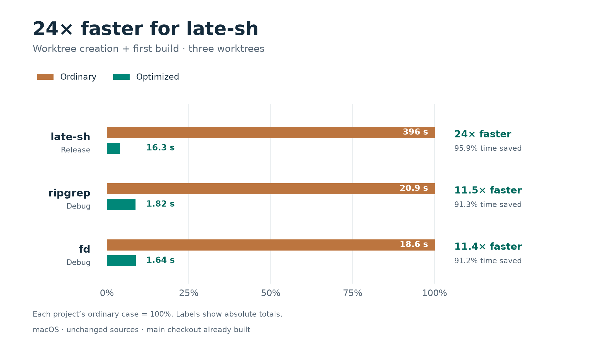
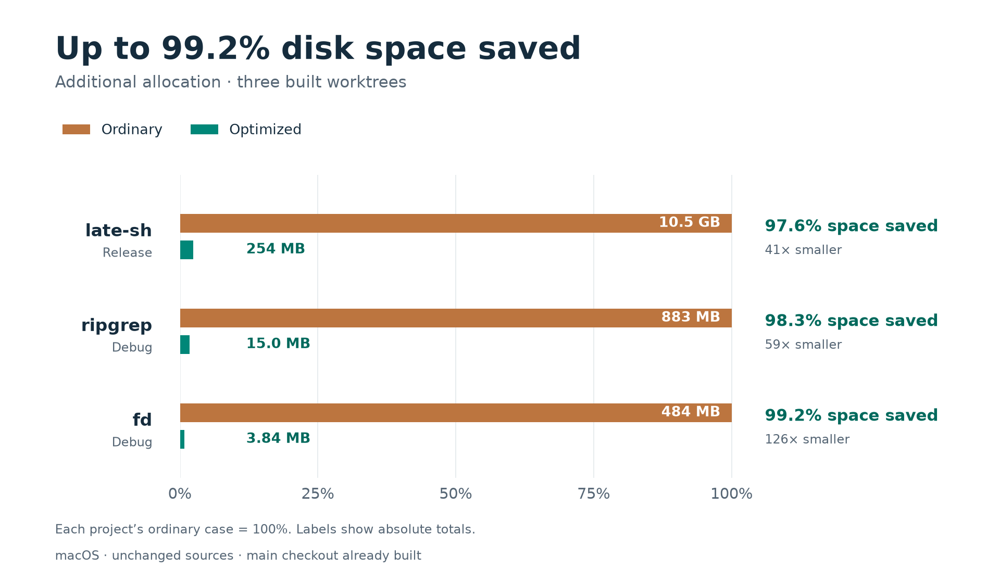

# Making Rust Development with AI Faster

- Created: 17 November 2026
- Last updated: 17 November 2026
- Status: Article draft for review before publication on dev.to
- Related framing: [Repository instructions](../../../AGENTS.md)
- Related rules: [Docs folder system](../../../.agents/skills/docs_folder_system/SKILL.md), [Folder constraints](../../../.agents/rules_of_the_repo/config/repo_folders_constraints/config.md)
- Related issue: [Article planning](https://github.com/jeromeetienne/faster-rust-worktrees/issues/11)

*With AI, each coding task gets its own worktree. Here’s how to create and build your rust worktrees more than 10 times faster.*

## Parallel coding agents multiply the same Rust build cost

I use a separate branch and worktree for each coding task. With three coding agents, a bug fix, a feature, and a test update can all move forward at once. Builds and tests run independently, and I review the changes before merging.

This is the [feature](https://docs.github.com/en/get-started/using-github/github-flow) [branch](https://about.gitlab.com/topics/version-control/what-is-gitlab-flow/) [workflow](https://nvie.com/posts/a-successful-git-branching-model/), extended with Git worktrees so several branches can be checked out at once. Separate working directories prevent edits for one task from disrupting a build for another.

The annoying part comes before any code changes. A fresh Rust worktree usually has an empty Cargo build folder, so the dependencies already compiled in the main checkout get compiled again. And again for the next task.

For [late-sh](https://github.com/mpiorowski/late-sh), a program I contributed to recently, the benchmark scaled to three worktrees gives **6 minutes 36 seconds ordinarily, compared with 16 seconds using Faster Rust Work Trees** for creation and first release builds: approximately **24 times faster**. [Details here](https://github.com/jeromeetienne/faster-rust-worktrees/blob/main/README.md).

Additional allocated space for those three worktrees falls from **10.5 GB to 254 MB**, saving about **10.2 GB**, with **41 times less** new allocation. Reusing compiled output can also reduce unnecessary writes and help extend drive lifetime. The lifetime gain depends on actual writes and other drive activity; disk allocation alone doesn’t measure wear.

## Reuse an existing build while keeping worktrees independent

[Faster Rust Work Trees](https://github.com/jeromeetienne/faster-rust-worktrees) gives each new worktree a copy of the main checkout’s Cargo output using **copy-on-write cloning**.

The file system initially stores unchanged contents in shared disk blocks. Each worktree still has its own files. Writing new data allocates separate blocks for the changes, leaving the other worktrees’ contents untouched.

That independence matters. A common build folder makes several coding agents write to the same output and potentially wait on each other. With cloned build folders, compilation for one task can replace output without affecting another task.

Sharing blocks saves disk space; reusing compiled output saves build time. But Cargo must still recognise the existing build as current.

The mechanism originated in [Heidrun Code](https://github.com/heidrun-org/heidrun_code/tree/main/packages/dev_tools/worktree_tools). Faster Rust Work Trees packages the same approach with a skill that guides your coding agent through repository setup and verification.

## Why cloning the build folder alone does not work

Copying the build folder is only part of the work. Fresh source timestamps and paths pointing to the original checkout can still cause Cargo to rebuild.

### Preserve exact dates for unchanged sources

Git gives newly checked-out source files fresh modification timestamps. Cargo uses timestamps when deciding whether to rebuild, so identical source code can look newer than the existing output and trigger compilation.

Faster Rust Work Trees restores the original timestamps only after checking that tracked regular files have identical contents. Changed files keep their new dates so Cargo can rebuild. Matching source directories also receive their original dates where appropriate.

The first ripgrep evaluation exposed a small but costly detail: JavaScript lost nanosecond precision when restoring timestamps, and one crate still compiled. Switching to Python’s nanosecond timestamp operations fixed the problem. The measured unchanged optimized builds then compiled zero crates.

### Relocate build-script records

Build scripts can record absolute paths for Cargo to watch. Those records are saved inside the build folder, as described in the [Cargo build-script documentation](https://doc.rust-lang.org/cargo/reference/build-scripts.html).

Cloned records may still point into the main checkout. Faster Rust Work Trees replaces those checkout prefixes with the new worktree’s path and restores the exact record timestamps. Paths embedded inside compiled programs or generated files may need additional handling specific to the repository.

### Keep the build settings consistent

A debug build won’t supply a missing release build. Changes to features, compiler versions, targets, environment settings, or commands can also require compilation. Prepare the main checkout using the same commands the new worktrees will run. Keep Cargo output inside each checkout and leave `CARGO_TARGET_DIR` unset. Stop builds before cloning: a build folder being modified is not a consistent snapshot.

The integration test checks both reuse and independence in a real Cargo workspace. An unchanged first build compiles no crates. After a dependency changes in one worktree, two concurrent builds produce independent results: the changed program prints `43`, while the other worktree and the original executable still print `42`.

## The numbers for three worktrees

Creation plus first-build time for three worktrees, with unchanged sources and a main checkout already built with matching settings:

Additional allocated space with three built worktrees retained together:

To get the three-worktree figures, the charts use three tenths of the ten-worktree measurements for late-sh timing and all storage results. Ripgrep and fd times use three times their one-worktree medians.

The one-worktree comparisons and the ripgrep and fd storage comparisons were repeated three times. The late-sh ten-worktree comparison has one complete paired run. All measured optimized unchanged first builds compiled zero crates.

The time totals cover sequential creation and first builds, not three simultaneous builds. Cloning and preparing output can make worktree creation itself slower. The saving comes in the first build. Initial compilation in the main checkout and later source changes still cost time.

Storage was measured on an isolated Apple File System volume with all worktrees retained together and shared blocks counted once. The figures exclude the built main checkout and common Cargo caches. Adding up apparent folder sizes would count shared data repeatedly.

The [late-sh measurements](https://github.com/jeromeetienne/faster-rust-worktrees/blob/main/docs/late_sh_measurements.md), [timing evaluation](https://github.com/jeromeetienne/faster-rust-worktrees/blob/main/docs/evaluation.md), and [storage measurements](https://github.com/jeromeetienne/faster-rust-worktrees/blob/main/docs/space_measurements.md) include conditions, raw evidence, and reproduction methods.

## Use the skill with your coding agent

The intended workflow is to let your coding agent handle setup and worktree creation. You don’t need to learn the underlying command-line tool.

Start by installing the [faster_rust_worktrees skill](https://github.com/jeromeetienne/faster-rust-worktrees/tree/main/skills/faster_rust_worktrees) for your coding agent. A skill is a reusable set of instructions. The [repository](https://github.com/jeromeetienne/faster-rust-worktrees) is the starting point for installation and setup details.

Once the skill is available, ask:

> Use faster_rust_worktrees to configure this Rust repository. Verify that unchanged builds reuse Cargo output and that source changes still build and test correctly. Integrate Faster Rust Work Trees into this repository’s worktree workflow.

The coding agent discovers the real build and test commands, prepares the main checkout’s output, checks file-system support, and verifies reuse in a disposable worktree. After those checks pass, the coding agent updates the repository’s worktree instructions so later coding tasks use the configured workflow.

Then ask for your next task as usual:

> Fix this issue in a new worktree, using the repository’s configured Faster Rust Work Trees workflow. Run the relevant tests and prepare the changes for review.

The coding agent creates the branch and worktree, reuses the existing build output, makes the changes, and runs the tests. You review the result. Source changes still require compilation; unchanged dependencies are where the repeated work can be avoided.

macOS has live verification. Linux support is implemented, but evaluation on a suitable Linux file system remains pending. The skill is still Draft, and unattended adoption hasn’t been evaluated, so the first setup includes verification in your actual repository.

The [setup reference](https://github.com/jeromeetienne/faster-rust-worktrees/blob/main/skills/faster_rust_worktrees/references/setup.md) covers requirements, configuration, and cleanup for the coding agent to follow.
