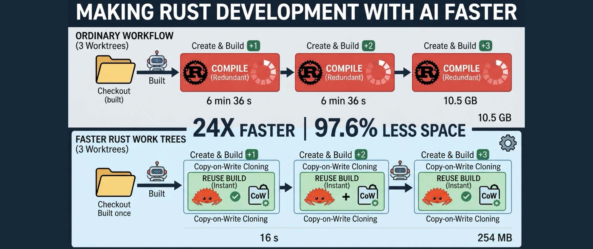

# Making Rust Development with AI Faster

- Created: 17 November 2026
- Last updated: 17 November 2026
- Status: Maintained overview for people
- Related framing: [Repository instructions](../../../AGENTS.md)
- Related rules: [Docs folder system](../../../.agents/skills/docs_folder_system/SKILL.md), [Folder constraints](../../../.agents/rules_of_the_repo/config/repo_folders_constraints/config.md)
- Related issue: [Article planning](https://github.com/jeromeetienne/faster-rust-worktrees/issues/11)

*With AI, each coding task gets its own worktree. Here’s how to create and build those worktrees more than 10 times faster.*

## Purpose

Plan a technical article about Faster Rust Work Trees for publication on dev.to. The title and subtitle above are agreed. The structure below is developed into the [article draft](ARTICLE.md), ready for review before publication.

## Article structure

1. **Parallel coding agents multiply the same Rust build cost.** Introduce the feature branch workflow, independent worktrees, repeated compilation, and one measured result.
2. **Reuse an existing build while keeping worktrees independent.** Explain copy-on-write cloning and illustrate independent build folders sharing unchanged disk blocks.
3. **Why cloning the build folder alone does not work.** Explain Cargo’s reuse checks and the handling of timestamps, recorded paths, and build settings.
4. **Follow one coding task from worktree creation to tested change.** Demonstrate setup, worktree creation, build reuse, a source change, and tests.
5. **What the measurements demonstrate.** Compare build time and additional allocated disk space, with measurement conditions and limits.
6. **Try Faster Rust Work Trees in your repository.** Give requirements, the starting command, and links to configuration and cleanup instructions.

## Reading this folder

Read [ARTICLE.md](ARTICLE.md) for the complete article draft. Read [PLAN.md](PLAN.md) for the intended content of each section, visual concepts, and evidence sources. See [index.md](index.md) for the folder contents.

## Main image



V5 resizes the user-provided V4 image to fit a 2400 × 1008 canvas, adding side padding to preserve all content. Embedded metadata has been removed. Earlier generated versions and their prompts remain available in [IMAGE_PROMPT.md](IMAGE_PROMPT.md).

### Removing image metadata

To export a copy without metadata, run this command from this article folder:

```bash
npx --yes --package sharp-cli sharp -i image-main-v5.png -o image-main-v5-without-metadata.png
```

[Sharp strips metadata by default](https://sharp.pixelplumbing.com/api-output/). This removes metadata such as Content Credentials, but does not guarantee removal of an invisible SynthID watermark embedded in the image. [OpenAI explains the difference between these provenance signals](https://help.openai.com/en/articles/8912793-provenance-signals-in-content-processed-by-openai-tools).

Metadata removal is sufficient for the intended image preparation. The command is documented here; the original images have not been changed.
