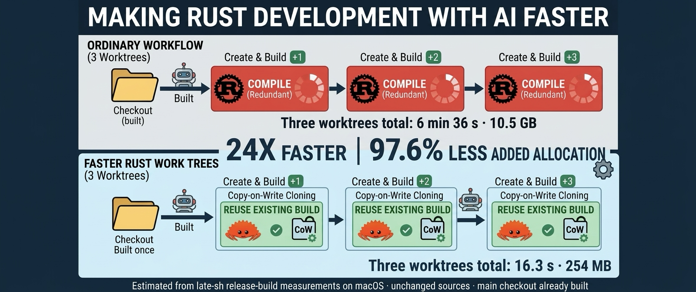

# Making Rust Development with AI Faster

- Created: 17 November 2026
- Last updated: 17 November 2026
- Status: Maintained overview for people
- Related framing: [Repository instructions](../../../AGENTS.md)
- Related rules: [Docs folder system](../../../.agents/skills/docs_folder_system/SKILL.md), [Folder constraints](../../../.agents/rules_of_the_repo/config/repo_folders_constraints/config.md)
- Related issue: [Article planning](https://github.com/jeromeetienne/faster-rust-worktrees/issues/11)

*With AI, each coding task gets its own worktree. Here’s how to create and build your rust worktrees more than 10 times faster.*

## Purpose

Plan a technical article about Faster Rust Work Trees for publication on dev.to. The title and subtitle above are agreed. The structure below is developed into the [article draft](ARTICLE.md), ready for review before publication.

## dev.to draft

The [existing dev.to draft](https://dev.to/jeromeetienne/making-rust-development-with-ai-faster-23p6/edit) remains unpublished. On 17 November 2026, the dev.to API update and readback verified that the body matches [ARTICLE.md](ARTICLE.md), with hosted chart URLs replacing local image paths, and that the cover uses [V6](image-main-v6.png). The three evaluation-document links use the current `docs/evaluation/` paths.

## Article structure

1. **Parallel coding agents multiply the same Rust build cost.** Introduce the feature branch workflow, independent worktrees, repeated compilation, and one measured result.
2. **Reuse an existing build while keeping worktrees independent.** Explain copy-on-write cloning and illustrate independent build folders sharing unchanged disk blocks.
3. **Why cloning the build folder alone does not work.** Explain Cargo’s reuse checks and the handling of timestamps, recorded paths, and build settings.
4. **The numbers for three worktrees.** Compare build time and additional allocated disk space, with measurement conditions and limits.
5. **Use the skill with your coding agent.** Explain skill installation, provide setup and task prompts, and describe the workflow the coding agent handles automatically.

## Reading this folder

Read [ARTICLE.md](ARTICLE.md) for the complete article draft. Read [PLAN.md](PLAN.md) for the intended content of each section, visual concepts, and evidence sources. See [index.md](index.md) for the folder contents.

Read [social_media.md](social_media.md) for six proposed posts and advice on sharing the article over several weeks.

## Main image



V6 is the current article cover and social media illustration. The user-provided correction labels time and allocation as totals for three worktrees, replaces the claim of instant reuse, and includes the measurement conditions. Earlier versions remain for reference; V5 fitted V4 to dev.to cover proportions. See [IMAGE_PROMPT.md](IMAGE_PROMPT.md) for the correction instructions and earlier prompts.

### Removing image metadata

To export a copy without metadata, run this command from this article folder:

```bash
npx --yes --package sharp-cli sharp -i image-main-v6.png -o image-main-v6-without-metadata.png
```

[Sharp strips metadata by default](https://sharp.pixelplumbing.com/api-output/). This removes metadata such as Content Credentials, but does not guarantee removal of an invisible SynthID watermark embedded in the image. [OpenAI explains the difference between these provenance signals](https://help.openai.com/en/articles/8912793-provenance-signals-in-content-processed-by-openai-tools).

Metadata removal is sufficient for the intended image preparation. The command is documented here; the original images have not been changed.
